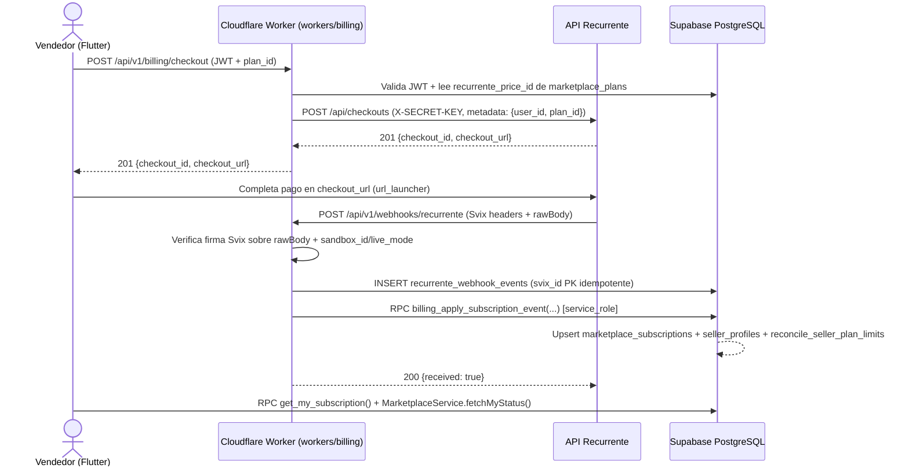

# Contrato Técnico, ADR-007 y Prompt de Delegación — Suscripciones Marketplace con Recurrente

**Versión:** 1.1  
**Fecha:** 26 de noviembre de 2026  
**Alcance:** Migración SQL (`supabase/`), Worker de facturación (`workers/billing/`), cliente Flutter (`comunidad_universitaria/`) y CI (`.github/workflows/flutter-tests.yml`).  
**Referencias oficiales de Recurrente:** [Prueba de credenciales (`GET /api/test`)](https://docs.recurrente.com/referencia-api/api-reference/test/credentials), [Primer pago de prueba](https://docs.recurrente.com/guias-espanol/comenzar/primer-pago-de-prueba), [Crear un checkout](https://docs.recurrente.com/referencia-api/api-reference/checkouts/create-checkout), [Webhooks](https://docs.recurrente.com/guias-espanol/comenzar/webhooks), [Actualizar una suscripción](https://docs.recurrente.com/referencia-api/api-reference/subscriptions/update-subscription), [Cambiar tarjeta de suscripción](https://docs.recurrente.com/guias-espanol/guias/cambiar-tarjeta-de-suscripcion), [Embedded Checkouts](https://docs.recurrente.com/guias-espanol/guias/embedded-checkouts) y [Sandboxes y Test Clocks](https://docs.recurrente.com/guides-english/guides/sandboxes-and-test-clocks).

---

## 1. Matriz de Entornos y Secretos

| Componente | Variable / Parámetro | Sandbox | Producción (Live) | Ubicación |
| :--- | :--- | :--- | :--- | :--- |
| Worker | `RECURRENTE_ENVIRONMENT` | `sandbox` | `live` | `wrangler.toml` (`[vars]`) |
| Worker | `RECURRENTE_EXPECTED_SANDBOX_ID` | ID del Sandbox nombrado | *(vacío / omitido)* | Secret / `.dev.vars` |
| Worker | `RECURRENTE_SECRET_KEY` | `sk_test_...` | `sk_live_...` | Secret / `.dev.vars` |
| Worker | `RECURRENTE_WEBHOOK_SECRET` | `whsec_...` (sandbox) | `whsec_...` (live) | Secret / `.dev.vars` |
| Worker | `SUPABASE_URL`, `SUPABASE_ANON_KEY`, `SUPABASE_SERVICE_ROLE_KEY` | Proyecto local o staging | `hfvsstkfqszpjrsrwhql` | Secret / `.dev.vars` |
| Worker | `ALLOWED_ORIGINS` | `http://localhost:<puerto>` | Dominio(s) oficiales | `wrangler.toml` (`[vars]`) |
| Flutter | `BILLING_WORKER_URL` | `http://127.0.0.1:8787` | URL del Worker desplegado | `--dart-define=BILLING_WORKER_URL=...` |
| DB | `marketplace_plans.recurrente_product_id` / `recurrente_price_id` | IDs de Sandbox | IDs de Live | Tabla `public.marketplace_plans` |

> [!CAUTION]
> En desarrollo local con [Embedded Checkouts](https://docs.recurrente.com/guias-espanol/guias/embedded-checkouts), el navegador debe abrirse en `http://localhost:<puerto>` o `https://` (no `http://127.0.0.1`). La app Flutter **nunca** debe almacenar `RECURRENTE_SECRET_KEY` ni `RECURRENTE_WEBHOOK_SECRET`.

---

## 2. ADR-007: Gestión de Suscripciones del Marketplace con Recurrente

*(Continúa la numeración de [docs/adr/ADRS_ZANATE.md](docs/adr/ADRS_ZANATE.md), cuyo último registro aprobado es ADR-006).*

- **Estado:** Propuesto / Listo para implementación  
- **Fecha:** 2026-11-26  
- **Contexto:** `public.marketplace_plans`, `public.seller_profiles`, `get_effective_seller_plan(user_id)` y `reconcile_seller_plan_limits(user_id)` ya implementan los límites y degradación automática de planes en Supabase (`20261113120000_marketplace_ux_backend.sql`), pero la contratación, renovación y cancelación de planes pagos requiere una pasarela recurrente en Guatemala (GTQ/USD).
- **Decisión:**
  1. Integrar la API de **Recurrente** (`https://app.recurrente.com/api`) exclusivamente desde un **Cloudflare Worker dedicado (`workers/billing/`)** en TypeScript + Vitest (siguiendo el mismo patrón arquitectónico de `workers/verification/`), donde residen `RECURRENTE_SECRET_KEY` (`X-SECRET-KEY`), `RECURRENTE_WEBHOOK_SECRET` (`whsec_...`) y `SUPABASE_SERVICE_ROLE_KEY`.
  2. La app Flutter (`comunidad_universitaria/`) **nunca** almacena llaves de Recurrente ni muta `seller_profiles.plan_id` o `plan_expires_at`; solo solicita sesiones de checkout/gestión con su JWT de Supabase y lee el estado resultante tras confirmación por webhook.
  3. Los webhooks de Recurrente (firmados vía Svix sobre el cuerpo crudo `rawBody`) son la **única fuente de verdad** para activar, renovar, marcar en mora (`past_due`) o cancelar suscripciones, persistiendo cada `svix-id` en una tabla de inbox idempotente (`public.recurrente_webhook_events`).
  4. Validar el ambiente al arrancar/desplegar con [`GET /api/test`](https://docs.recurrente.com/referencia-api/api-reference/test/credentials), exigiendo coincidencia estricta de `environment` (`sandbox` vs `live`) y `sandbox_id` en los webhooks entrantes.
- **Consecuencias:**
  - **Positivas:** Cero exposición de secretos en el cliente; idempotencia ante reintentos de Svix; compatibilidad directa con `get_effective_seller_plan`, `reconcile_seller_plan_limits` y `Zanate-admin`; pruebas reproducibles con **Sandboxes nombrados y Test Clocks**.
  - **Negativas / Restricciones:** Los `recurrente_product_id` y `recurrente_price_id` en `marketplace_plans` difieren entre Sandbox y Live y deben parametrizarse por entorno.

---

## 3. Flujo End-to-End (Checkout y Webhook)



---

## 4. Contrato de Base de Datos (`supabase/`)

Crear mediante `supabase migration new recurrente_marketplace_subscriptions` con SQL completamente idempotente:

```sql
-- 1. Mapear planes del Marketplace a IDs de Recurrente (específicos por ambiente)
ALTER TABLE public.marketplace_plans
  ADD COLUMN IF NOT EXISTS recurrente_product_id text,
  ADD COLUMN IF NOT EXISTS recurrente_price_id text;

-- 2. Ampliar tipos permitidos en public.user_notifications para alertas de facturación
ALTER TABLE public.user_notifications
  DROP CONSTRAINT IF EXISTS user_notifications_type_check;
ALTER TABLE public.user_notifications
  ADD CONSTRAINT user_notifications_type_check
  CHECK (type = ANY (ARRAY[
    'comment'::text,
    'reply'::text,
    'like'::text,
    'new_post'::text,
    'billing_past_due'::text,
    'billing_cancelled'::text
  ]));

-- 3. Estado de suscripción Recurrente por vendedor (1 suscripción abierta a la vez)
CREATE TABLE IF NOT EXISTS public.marketplace_subscriptions (
  id uuid PRIMARY KEY DEFAULT gen_random_uuid(),
  user_id uuid NOT NULL REFERENCES auth.users(id) ON DELETE CASCADE,
  plan_id text NOT NULL REFERENCES public.marketplace_plans(id) ON UPDATE CASCADE,
  recurrente_customer_id text,
  recurrente_subscription_id text NOT NULL UNIQUE,
  status text NOT NULL CHECK (status IN ('active', 'past_due', 'paused', 'cancelled')),
  current_period_start timestamptz,
  current_period_end timestamptz,
  cancel_at_period_end boolean NOT NULL DEFAULT false,
  sandbox_id text,
  live_mode boolean NOT NULL DEFAULT true,
  created_at timestamptz NOT NULL DEFAULT now(),
  updated_at timestamptz NOT NULL DEFAULT now()
);

CREATE INDEX IF NOT EXISTS idx_marketplace_subscriptions_user
  ON public.marketplace_subscriptions (user_id, created_at DESC);

CREATE UNIQUE INDEX IF NOT EXISTS idx_marketplace_subscriptions_one_open
  ON public.marketplace_subscriptions (user_id)
  WHERE status IN ('active', 'past_due', 'paused');

DROP TRIGGER IF EXISTS trg_marketplace_subscriptions_updated_at ON public.marketplace_subscriptions;
CREATE TRIGGER trg_marketplace_subscriptions_updated_at
  BEFORE UPDATE ON public.marketplace_subscriptions
  FOR EACH ROW
  EXECUTE FUNCTION _triggers.set_updated_at();

ALTER TABLE public.marketplace_subscriptions ENABLE ROW LEVEL SECURITY;
REVOKE ALL ON TABLE public.marketplace_subscriptions FROM PUBLIC, anon, authenticated;
GRANT SELECT ON TABLE public.marketplace_subscriptions TO authenticated;
GRANT ALL ON TABLE public.marketplace_subscriptions TO service_role, postgres;

DROP POLICY IF EXISTS marketplace_subscriptions_select_own ON public.marketplace_subscriptions;
CREATE POLICY marketplace_subscriptions_select_own
  ON public.marketplace_subscriptions
  FOR SELECT TO authenticated
  USING (user_id = auth.uid() OR public.is_marketplace_staff(auth.uid()));

-- 4. Inbox idempotente de webhooks Svix / Recurrente (solo service_role)
CREATE TABLE IF NOT EXISTS public.recurrente_webhook_events (
  svix_id text PRIMARY KEY,
  event_type text NOT NULL,
  sandbox_id text,
  live_mode boolean NOT NULL DEFAULT true,
  payload jsonb NOT NULL,
  processing_status text NOT NULL DEFAULT 'received'
    CHECK (processing_status IN ('received', 'processed', 'ignored', 'failed')),
  error_message text,
  received_at timestamptz NOT NULL DEFAULT now(),
  processed_at timestamptz
);

ALTER TABLE public.recurrente_webhook_events ENABLE ROW LEVEL SECURITY;
REVOKE ALL ON TABLE public.recurrente_webhook_events FROM PUBLIC, anon, authenticated;
GRANT ALL ON TABLE public.recurrente_webhook_events TO service_role, postgres;
```

### RPCs requeridos en la misma migración

| RPC | Rol autorizado | Responsabilidad |
| :--- | :--- | :--- |
| `public.billing_apply_subscription_event(p_user_id uuid, p_plan_id text, p_recurrente_subscription_id text, p_recurrente_customer_id text, p_status text, p_period_start timestamptz, p_period_end timestamptz, p_cancel_at_period_end boolean, p_sandbox_id text, p_live_mode boolean, p_event_type text)` | `service_role`, `postgres` | Hace `UPSERT` en `marketplace_subscriptions`. Hace `INSERT ... ON CONFLICT (user_id) DO UPDATE` en `seller_profiles` (el trigger `enforce_seller_admin_fields()` exime a `service_role`): si `p_status = 'active'` o `cancel_at_period_end = true` con `p_period_end > now()`, sincroniza `plan_id = p_plan_id` y `plan_expires_at = p_period_end`; si se cancela inmediatamente o vence el período, degrada `plan_id = 'free'`, `plan_expires_at = NULL` e invoca `reconcile_seller_plan_limits(p_user_id)`. Inserta en `user_notifications` (`type = 'billing_past_due'` o `'billing_cancelled'`) cuando corresponda. |
| `public.get_my_subscription()` | `authenticated`, `service_role` | Devuelve el registro vigente (o último) de `marketplace_subscriptions` para `auth.uid()` (`id`, `plan_id`, `status`, `current_period_start`, `current_period_end`, `cancel_at_period_end`, `updated_at`), sin exponer payloads internos. |

### Pruebas pgTAP
- Archivo: `supabase/tests/database/marketplace_subscriptions_test.sql`
- Validar RLS por rol (`anon`, `authenticated`, `service_role`), unicidad de suscripción abierta (`idx_marketplace_subscriptions_one_open`), idempotencia de `recurrente_webhook_events`, inserción de notificaciones `billing_past_due` / `billing_cancelled`, upsert en `seller_profiles` y degradación con `reconcile_seller_plan_limits`.

---

## 5. Contrato del Worker (`workers/billing/`)

Seguir la estructura y convenciones de `workers/verification/` (Wrangler + TypeScript + Vitest + `svix`):

```text
workers/billing/
├── package.json              # Deps: svix, @supabase/supabase-js; dev: @cloudflare/workers-types, typescript, vitest, wrangler
├── package-lock.json         # Requerido para `npm ci` en GitHub Actions
├── tsconfig.json             # Alineado con workers/verification/tsconfig.json
├── vitest.config.ts          # Configuración de Vitest
├── wrangler.toml             # compatibility_date = "2026-11-10", compatibility_flags = ["nodejs_compat"], vars (RECURRENTE_ENVIRONMENT, ALLOWED_ORIGINS)
├── .dev.vars.example         # Plantilla local sin secretos reales
├── src/
│   ├── index.ts              # Router HTTP + CORS (GET, POST, PUT, DELETE, OPTIONS; headers authorization, content-type)
│   ├── types.ts              # Env (incl. RECURRENTE_ENVIRONMENT, RECURRENTE_EXPECTED_SANDBOX_ID, RECURRENTE_SECRET_KEY, RECURRENTE_WEBHOOK_SECRET, SUPABASE_*) y DTOs
│   ├── recurrente.ts         # Cliente HTTP (base https://app.recurrente.com/api, header X-SECRET-KEY)
│   ├── supabase.ts           # Validación JWT (createAnonClient) + cliente service_role (createServiceClient) + check staff en user_roles
│   └── handlers/
│       ├── health.ts         # GET /api/v1/health y GET /api/v1/health/recurrente (usa GET /api/test)
│       ├── checkout.ts       # POST /api/v1/billing/checkout y POST /api/v1/billing/setup-card
│       ├── subscription.ts   # PUT /api/v1/billing/subscription y DELETE /api/v1/billing/subscription
│       └── webhook.ts        # POST /api/v1/webhooks/recurrente (verificación Svix + idempotencia)
└── test/
    ├── webhook.test.ts       # Firma Svix válida/inválida, sandbox_id mismatch, idempotencia svix-id
    ├── checkout.test.ts      # Creación de checkout con metadata { user_id, plan_id } y validación JWT
    └── subscription.test.ts  # Cambio de plan, pausa, cambio de tarjeta y cancelación
```

### Contratos HTTP del Worker

| Método y Ruta | Auth | Acción en Recurrente / Supabase | Respuesta |
| :--- | :--- | :--- | :--- |
| `GET /api/v1/health` | Pública | Verifica salud del Worker | `200 { "status": "ok", "service": "comunidad-usac-billing" }` |
| `GET /api/v1/health/recurrente` | Staff (`JWT` + `user_roles.role IN ('admin', 'moderator')`, igual que `workers/verification/`) | Llama [`GET /api/test`](https://docs.recurrente.com/referencia-api/api-reference/test/credentials) y valida `environment` y `sandbox_id` | `200 { "status": "ok", "environment": "...", "sandbox_id": "..." }` |
| `POST /api/v1/billing/checkout` | JWT Supabase (`authenticated`) | Valida vendedor + lee `recurrente_price_id` de `marketplace_plans` + llama [`POST /api/checkouts`](https://docs.recurrente.com/referencia-api/api-reference/checkouts/create-checkout) con `metadata: { user_id, plan_id }` | `201 { "checkout_id": "...", "checkout_url": "..." }` |
| `POST /api/v1/billing/setup-card` | JWT Supabase (`authenticated`) | Crea checkout en `mode: "setup"` ([Cambiar tarjeta](https://docs.recurrente.com/guias-espanol/guias/cambiar-tarjeta-de-suscripcion)) con `metadata: { user_id, purpose: "update_card" }` | `201 { "checkout_id": "...", "checkout_url": "..." }` |
| `PUT /api/v1/billing/subscription` | JWT Supabase (`authenticated`) | Verifica propiedad de la suscripción y llama [`PUT /api/subscriptions/{id}`](https://docs.recurrente.com/referencia-api/api-reference/subscriptions/update-subscription) (`items` + `mode`, `act: "pause"\|"unpause"` o `payment_method_id`) | `200 { "status": "ok", "subscription": {...} }` |
| `DELETE /api/v1/billing/subscription` | JWT Supabase (`authenticated`) | Verifica propiedad y llama `DELETE /api/subscriptions/{id}` | `200 { "status": "cancelled" }` |
| `POST /api/v1/webhooks/recurrente` | Firma Svix (`svix-id`, `svix-timestamp`, `svix-signature`) | Verifica firma sobre `rawBody`, valida `sandbox_id`/`live_mode`, inserta `svix_id` en `recurrente_webhook_events`, procesa eventos y llama `billing_apply_subscription_event` | `200 { "received": true }` |

### Reglas obligatorias del handler de Webhooks

1. **Formato de eventos:** consumir el formato unificado `intent.succeeded` / `intent.failed` y los eventos `subscription.create`, `subscription.past_due`, `subscription.pause`, `subscription.cancel`, `setup_intent.succeeded`. **Ignorar** `payment_intent.succeeded` si la cuenta también emite el evento legacy, para nunca aplicar un pago dos veces ([Primer pago de prueba](https://docs.recurrente.com/guias-espanol/comenzar/primer-pago-de-prueba)).
2. **Validación de ambiente:** si `RECURRENTE_ENVIRONMENT === 'sandbox'`, rechazar (`400`) cualquier webhook cuyo `sandbox_id` no coincida con `RECURRENTE_EXPECTED_SANDBOX_ID` o que venga con `live_mode: true`. En `live`, rechazar cualquier evento con `live_mode: false`.
3. **Verificación de firma:** usar `svix` (`new Webhook(env.RECURRENTE_WEBHOOK_SECRET).verify(rawBody, headers)`) sobre el texto crudo de la petición; nunca parsear y volver a serializar el JSON antes de verificar ([Webhooks](https://docs.recurrente.com/guias-espanol/comenzar/webhooks)).
4. **Actualización de tarjeta automática:** al recibir `setup_intent.succeeded` con `metadata.purpose === "update_card"`, extraer `payment_method.id` y llamar automáticamente a `PUT /api/subscriptions/{id}` con `payment_method_id`.

---

## 6. Contrato de Integración en Flutter (`comunidad_universitaria/`)

Siguiendo la arquitectura actual del cliente (`lib/core/config/`, `lib/core/models/`, `lib/core/services/`):

- **Configuración (`lib/core/config/billing_config.dart`):**
  - Clase `BillingConfig` (análogo a `SupportConfig` y `SupabaseConfig`) con `workerUrl` leído vía `String.fromEnvironment('BILLING_WORKER_URL')`, sin exponer ninguna llave de Recurrente.
- **Modelo (`lib/core/models/marketplace_subscription.dart`):**
  - `MarketplaceSubscription` con `fromMap`/`fromJson` (`id`, `planId`, `status`, `currentPeriodStart`, `currentPeriodEnd`, `cancelAtPeriodEnd`, `updatedAt`) y helpers (`isActive`, `isPastDue`, `isPaused`, `isCancelled`).
- **Servicio inyectable (`lib/core/services/billing_service.dart`):**
  - Usa `http.Client` y `SupabaseClient` inyectables para pruebas unitarias sin red (`url_launcher` y `http` ya están en `pubspec.yaml`).
  - `createCheckoutSession(String planId)` → devuelve `checkoutUrl`.
  - `createCardSetupSession()` → devuelve `checkoutUrl` para cambiar tarjeta.
  - `changePlan(String newPlanId, {String mode = 'next_cycle'})` / `cancelSubscription()`.
  - `fetchMySubscription()` → llama al RPC `get_my_subscription()`.
- **UI (`lib/features/marketplace/widgets/marketplace_plans_sheet.dart`):**
  - Aceptar `BillingService? billingService` opcional en el constructor para mantener determinismo en `marketplace_plans_sheet_test.dart`.
  - Para el plan `free`, mostrar indicador de plan base / actual sin lanzar checkout.
  - Para planes pagos, reemplazar la llamada actual a `SponsorRequestDialog.show(...)` por `BillingService.createCheckoutSession(plan.id)` y abrir `checkout_url` con `url_launcher`.
  - Al volver a la app (o al pulsar "Ya completé mi pago"), refrescar `MarketplaceService.fetchMyStatus()` y `BillingService.fetchMySubscription()`; mostrar estado "Confirmando pago…" si el webhook aún está en tránsito.
  - Si `subscription.status == 'past_due'`, mostrar banner con CTA "Actualizar tarjeta" que lanza `createCardSetupSession()`.
- **Tests (`comunidad_universitaria/test/`):**
  - `test/models/marketplace_subscription_test.dart`
  - `test/services/billing_service_test.dart`
  - Actualizar `test/widgets/marketplace_plans_sheet_test.dart` (sin llamadas reales de red).

---

## 7. CI/CD y Criterios de Aceptación

- **CI (`.github/workflows/flutter-tests.yml`):**
  - Agregar el job `billing-worker-tests` (análogo a `worker-tests` de `workers/verification/`) ejecutando `npm ci && npm test` en `workers/billing/` con `cache-dependency-path: workers/billing/package-lock.json`.
  - Recordatorio: `flutter-test` ejecuta `python3 scripts/ci/check_sql_contracts.py`, por lo que `public.get_my_subscription()` debe existir en `supabase/migrations/` antes o en el mismo PR que `BillingService`.
- **Verificación obligatoria:**
  1. `./scripts/db/run_pgtap.sh` (o `supabase test db`) pasando al 100%, incluyendo `supabase/tests/database/marketplace_subscriptions_test.sql`.
  2. `npm run typecheck && npm test` en `workers/billing/` pasando al 100%.
  3. `python3 scripts/ci/check_sql_contracts.py`, `flutter analyze` y `flutter test` en `comunidad_universitaria/` pasando al 100%.
  4. `rg -n "X-SECRET-KEY|sk_live_|sk_test_|whsec_" comunidad_universitaria/lib/` sin coincidencias.

---

## 8. Prompt Listo para Delegar al Subagente (SA-7: Suscripciones Marketplace Recurrente)

```text
Eres un ingeniero senior Full-Stack (Supabase PostgreSQL, Cloudflare Workers TypeScript y Flutter) encargado de implementar el manejo de suscripciones del Marketplace de Comunidad_USAC (Zanate) usando la API de Recurrente.

CONTRATO ARQUITECTÓNICO DE REFERENCIA:
- Sigue estrictamente ADR-007 y el contrato definido en `contrato_recurrente_marketplace.md`.
- La app Flutter NUNCA debe contener `RECURRENTE_SECRET_KEY` ni `RECURRENTE_WEBHOOK_SECRET`, y NUNCA debe activar planes al volver de `success_url`. Los webhooks firmados con Svix son la única fuente de verdad.
- Base URL de Recurrente: `https://app.recurrente.com/api` con header `X-SECRET-KEY` (sin llave pública).
- No modifiques archivos fuera de los listados en el alcance.

ALCANCE ESTRICTO DE ARCHIVOS:
1. Base de datos (`supabase/`):
   - Crear una migración idempotente (`supabase migration new recurrente_marketplace_subscriptions`) que:
     - Agregue `recurrente_product_id` y `recurrente_price_id` a `public.marketplace_plans`.
     - Actualice `user_notifications_type_check` en `public.user_notifications` para permitir `'billing_past_due'` y `'billing_cancelled'`.
     - Cree `public.marketplace_subscriptions` y `public.recurrente_webhook_events` con `ENABLE ROW LEVEL SECURITY`, `REVOKE ALL` y `GRANT` explícitos.
     - Cree los RPCs `public.billing_apply_subscription_event(...)` (solo `service_role`/`postgres`, haciendo upsert en `marketplace_subscriptions` y `seller_profiles`, respetando `cancel_at_period_end`, invocando `reconcile_seller_plan_limits` al cancelar/vencer y registrando en `user_notifications`) y `public.get_my_subscription()` (`authenticated`).
   - Crear pruebas pgTAP en `supabase/tests/database/marketplace_subscriptions_test.sql` validando RLS por rol (`anon`, `authenticated`, `service_role`), unicidad de suscripción abierta, idempotencia de `recurrente_webhook_events`, constraint de `user_notifications` y degradación con `reconcile_seller_plan_limits`.

2. Cloudflare Worker (`workers/billing/`):
   - Crear el worker en TypeScript siguiendo el patrón de `workers/verification/` (incluyendo `package.json`, `package-lock.json`, `tsconfig.json`, `vitest.config.ts`, `wrangler.toml`, `.dev.vars.example` y `svix` para verificar firmas sobre `rawBody`).
   - Configurar CORS con métodos `GET, POST, PUT, DELETE, OPTIONS` y validar staff en `user_roles` (`admin`/`moderator`) igual que `workers/verification/`.
   - Implementar:
     - `GET /api/v1/health` y `GET /api/v1/health/recurrente` (validando `GET /api/test` contra `RECURRENTE_ENVIRONMENT` y `RECURRENTE_EXPECTED_SANDBOX_ID`).
     - `POST /api/v1/billing/checkout` (JWT Supabase -> `POST /api/checkouts` con `metadata: { user_id, plan_id }`).
     - `POST /api/v1/billing/setup-card` (JWT Supabase -> `POST /api/checkouts` con `mode: "setup"`).
     - `PUT /api/v1/billing/subscription` y `DELETE /api/v1/billing/subscription`.
     - `POST /api/v1/webhooks/recurrente` (verificación Svix sobre `rawBody`, validación de `sandbox_id`/`live_mode`, deduplicación por `svix-id` en `recurrente_webhook_events`, soporte para `subscription.create`, `subscription.past_due`, `subscription.pause`, `subscription.cancel`, `intent.succeeded`, `intent.failed` y `setup_intent.succeeded`, ignorando duplicados legacy `payment_intent.succeeded`).
   - Crear pruebas unitarias Vitest en `workers/billing/test/` cubriendo firma válida/inválida, rechazo por `sandbox_id` incorrecto, idempotencia de reintentos y flujos de checkout/suscripción.

3. Flutter (`comunidad_universitaria/`):
   - Crear `lib/core/config/billing_config.dart` (`BILLING_WORKER_URL` vía `--dart-define`), `lib/core/models/marketplace_subscription.dart` y `lib/core/services/billing_service.dart` (inyectable para tests).
   - Actualizar `lib/features/marketplace/widgets/marketplace_plans_sheet.dart` para iniciar checkout en planes pagos (reemplazando `SponsorRequestDialog`), dejar `free` como plan base sin checkout, abrir `checkout_url` con `url_launcher`, refrescar estado al volver y mostrar CTA "Actualizar tarjeta" cuando `status == 'past_due'`.
   - Agregar/actualizar tests en `test/models/marketplace_subscription_test.dart`, `test/services/billing_service_test.dart` y `test/widgets/marketplace_plans_sheet_test.dart` sin llamadas reales de red.

4. CI (`.github/workflows/flutter-tests.yml`):
   - Agregar un job `billing-worker-tests` que ejecute `npm ci && npm test` en `workers/billing/` usando `cache-dependency-path: workers/billing/package-lock.json`.

CRITERIOS DE ACEPTACIÓN Y VERIFICACIÓN:
- `supabase test db` (o `./scripts/db/run_pgtap.sh`) pasando al 100% (incluyendo `marketplace_subscriptions_test.sql`).
- `npm run typecheck && npm test` en `workers/billing/` pasando al 100%.
- `python3 scripts/ci/check_sql_contracts.py`, `flutter analyze` y `flutter test` en `comunidad_universitaria/` pasando al 100%.
- Confirmar con `rg` / `grep` que no existe ninguna referencia a `X-SECRET-KEY`, `sk_live_`, `sk_test_` o `whsec_` dentro de `comunidad_universitaria/lib/`.
- Documentar en la respuesta los pasos exactos para probar el flujo con un Sandbox nombrado y un Test Clock de Recurrente.
```
