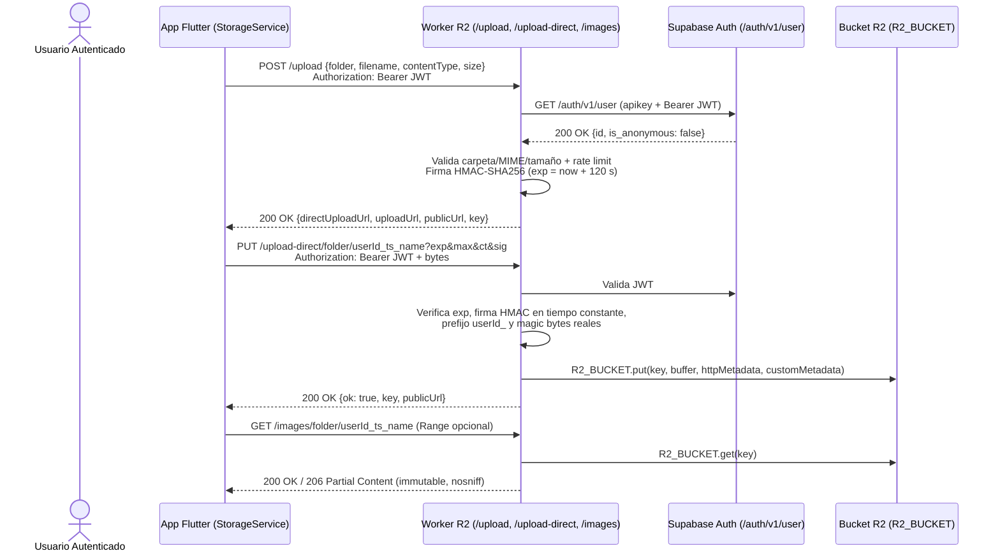

# Fase 2: Cloudflare Worker R2 — Arquitectura, Seguridad y Despliegue

Documentación completa del servicio de almacenamiento multimedia en `worker/`, creado para reemplazar el esquema inseguro de subida directa sin CORS hacia R2.

---

## 1. Inventario de archivos en `worker/`

| Archivo | Propósito |
| :--- | :--- |
| [src/index.js](../../worker/src/index.js) | Código fuente del Worker en ES Modules sin dependencias externas (`npm`), compatible con Cloudflare Workers y pruebas unitarias en Node 22. |
| [wrangler.toml](../../worker/wrangler.toml) | Configuración de despliegue (`name = "comunidad-usac-storage"`, binding `R2_BUCKET` -> bucket `comunidad-usac-storage`, trigger cron `0 */6 * * *`, `SUPABASE_URL`). |
| [package.json](../../worker/package.json) | Scripts `dev`, `deploy` y `test` (`node --test test/storage-worker.test.mjs`). |
| [.dev.vars.example](../../worker/.dev.vars.example) | Plantilla de secretos locales para `wrangler dev`. |
| [test/storage-worker.test.mjs](../../worker/test/storage-worker.test.mjs) | Suite automatizada con `node:test` y mock en memoria de R2 y Auth. |
| [README.md](../../worker/README.md) | Resumen operativo rápido en la carpeta del Worker. |

---

## 2. Secuencia completa de subida y lectura



---

## 3. Contrato de endpoints

### 3.1 `OPTIONS *` y `GET /health`
- `OPTIONS`: responde `204 No Content` con `Access-Control-Allow-Methods: GET, HEAD, POST, PUT, OPTIONS` y `Access-Control-Allow-Headers: Content-Type, Authorization, Range`.
- `GET /health`: responde `200 OK` con `{"status":"ok","service":"comunidad-usac-storage"}`.

### 3.2 `POST /upload` (solicitud de autorización firmada)
- **Cabecera obligatoria:** `Authorization: Bearer <supabase_jwt>`.
- **Cuerpo JSON:**
  ```json
  {
    "folder": "forum",
    "filename": "foto.jpg",
    "contentType": "image/jpeg",
    "size": 245120
  }
  ```
- **Reglas validadas:**
  - Si falta token, es inválido o `user.is_anonymous === true` -> `401`.
  - Si `folder` o `filename` contienen `..`, `/`, `\` o byte nulo -> `400`.
  - Si `folder` no está en la lista blanca o el `contentType` no corresponde a esa carpeta -> `400`.
  - Si `size` excede el límite de la carpeta -> `413`.
  - Si el `userId` excede la cuota de frecuencia -> `429` con cabecera `Retry-After`.
- **Respuesta `200 OK`:**
  - `directUploadUrl` y `uploadUrl`: URL firmada de `PUT /upload-direct/<key>?exp=...&max=...&ct=...&sig=...` (apuntan al propio Worker para evitar bloqueos CORS del dominio `r2.cloudflarestorage.com`).
  - `publicUrl`: `${origin}/images/<key>`.
  - `key`: `<folder>/<userId>_<ts>_<safeName>`.
  - `expiresIn`: `120`.

### 3.3 `PUT /upload-direct/<key>` (carga binaria validada)
- **Cabeceras obligatorias:** `Authorization: Bearer <supabase_jwt>`, `Content-Type`.
- **Validaciones antes de escribir en R2:**
  1. Verifica sesión en Supabase Auth (`401`).
  2. Comprueba que `<key>` sea `<folder>/<filename>` válido y que `filename` comience con `${auth.userId}_` (`403`).
  3. Verifica `exp >= nowSec`, que `max` no supere el tope de carpeta, que `ct` sea permitido y que `sig` coincida con HMAC-SHA256(`UPLOAD_SIGNING_SECRET`, `${key}|${ct}|${max}|${userId}|${exp}`) mediante comparación en tiempo constante (`403`).
  4. Lee el cuerpo binario: rechaza cuerpo vacío (`400`) o tamaño `> max` (`413`).
  5. Comprueba **magic bytes** del binario (`415 Unsupported Media Type` si el contenido no corresponde al MIME declarado).
- **Escritura en R2:** guarda `httpMetadata.contentType`, `httpMetadata.cacheControl = 'public, max-age=31536000, immutable'` y `customMetadata: { uploadedBy, folder }`.

### 3.4 `GET /images/<key>` y `HEAD /images/<key>`
- Solo sirve llaves bajo `forum/`, `forum_videos/`, `groups/` o `listings/`.
- Soporta cabecera `Range: bytes=start-end` consultando `R2_BUCKET.head(key)` + `R2_BUCKET.get(key, { range })` para responder `206 Partial Content` con `Content-Range` y `Accept-Ranges: bytes` (imprescindible para streaming y seek de video en `video_player`).
- Adjunta cabeceras de seguridad y caché:
  - `Cache-Control: public, max-age=31536000, immutable`
  - `X-Content-Type-Options: nosniff`
  - `Content-Disposition: inline`

---

## 4. Políticas de carpetas, magic bytes y rate limit

### 4.1 Carpetas, tipos MIME y tamaños máximos

| Carpeta | Uso | Tipos MIME permitidos | Límite máximo |
| :--- | :--- | :--- | :--- |
| `forum` | Imágenes de publicaciones del foro | `image/jpeg`, `image/png`, `image/webp` | **2 MB** (`2097152` bytes) |
| `groups` | Imágenes / logotipos de grupos | `image/jpeg`, `image/png`, `image/webp` | **2 MB** (`2097152` bytes) |
| `listings` | Fotos de publicaciones del marketplace | `image/jpeg`, `image/png`, `image/webp` | **2 MB** (`2097152` bytes) |
| `forum_videos` | Videos de publicaciones del foro (exclusivo) | `video/mp4`, `video/webm`, `video/quicktime` | **15 MB** (`15728640` bytes) |

### 4.2 Firmas binarias (magic bytes) verificadas

| Tipo MIME | Firma verificada |
| :--- | :--- |
| `image/jpeg` | Bytes `0..2` = `FF D8 FF` |
| `image/png` | Bytes `0..7` = `89 50 4E 47 0D 0A 1A 0A` |
| `image/webp` | `RIFF` en `0..3` y `WEBP` en `8..11` |
| `video/mp4` | `ftyp` en `4..7` |
| `video/quicktime` | Átomo `ftyp`, `moov`, `mdat`, `wide` o `free` en `4..7` |
| `video/webm` | Bytes `0..3` = `1A 45 DF A3` (EBML) |

### 4.3 Rate limit por usuario y limpieza de huérfanos
- **Imágenes:** máximo **6** solicitudes por cada **60 segundos** por `userId`.
- **Videos:** máximo **2** solicitudes por cada **300 segundos** por `userId`.
- **Cron `0 */6 * * *` (`cleanupOrphanObjects`):** si está configurado `SUPABASE_SERVICE_ROLE_KEY`, escanea hasta `500` objetos por ejecución en `R2_BUCKET`, consulta por `GET` las referencias activas en `posts` (`image_url`, `video_url` con fallback a `image_url`), `student_groups` (`image_url`) y `marketplace_items` (`image_urls`), y elimina únicamente objetos con antigüedad superior a **2 horas** sin referencia en BD.

---

## 5. Runbook de despliegue en Cloudflare y pruebas

### 5.1 Pruebas locales (ya ejecutadas)
```bash
cd worker
npm test
```
Resultado observado: **8 de 8 pruebas aprobadas** en [storage-worker.test.mjs](../../worker/test/storage-worker.test.mjs) (`OPTIONS`, rechazo `401` anónimo/sin token, rechazo de videos fuera de `forum_videos`, path traversal `400`, exceso `413`, flujo completo imagen + `Cache-Control`, spoofing `415` y firma adulterada `403`, streaming `Range 206`, rate limit `429` y limpieza cron de huérfanos).

### 5.2 Despliegue a producción (`comunidad-usac-storage`)
Ejecuta estos comandos desde tu terminal en `worker/`:

```bash
cd worker

# 1. Autenticarte en tu cuenta de Cloudflare
npx wrangler login

# 2. Definir secretos obligatorios (Wrangler pedirá el valor de forma interactiva)
npx wrangler secret put SUPABASE_ANON_KEY
npx wrangler secret put UPLOAD_SIGNING_SECRET   # Recomendado: generar con `openssl rand -hex 32`

# 3. Secreto opcional para habilitar la limpieza cron de archivos huérfanos cada 6 h
npx wrangler secret put SUPABASE_SERVICE_ROLE_KEY

# 4. Desplegar el Worker y verificar el binding R2
npx wrangler deploy

# 5. Comprobación rápida tras el despliegue
curl -i https://comunidad-usac-storage.carlosdelcidramirez.workers.dev/health
curl -i -X POST https://comunidad-usac-storage.carlosdelcidramirez.workers.dev/upload \
  -H "Content-Type: application/json" \
  -d '{"folder":"forum","filename":"test.jpg","contentType":"image/jpeg","size":100}'
# Debe responder HTTP 401 Unauthorized (confirmando que ya no está abierto al público)
```

*(Nota: si en producción quieres restringir CORS exclusivamente a tus dominios web, actualiza `ALLOWED_ORIGINS` en [wrangler.toml](../../worker/wrangler.toml), por ejemplo `"https://zanate.pages.dev,http://localhost:8080"`, antes de correr `npx wrangler deploy`).*
