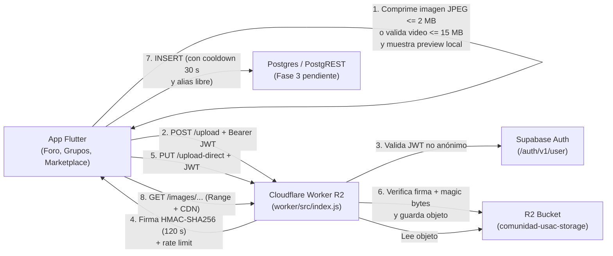

# Documentación Técnica: Medios R2, Compresión, Seguridad y Alias Único

Serie de documentos técnicos que detalla la arquitectura, contratos, invariantes de seguridad, pruebas y despliegue de la iniciativa de medios y endurecimiento en **Comunidad USAC**.

---

## 1. Índice de documentos

| Documento | Alcance | Audiencia principal |
| :--- | :--- | :--- |
| [01-flutter-medios-y-compresion.md](01-flutter-medios-y-compresion.md) | `StorageService`, compresión JPEG multiplataforma, vistas previas locales `Image.memory`, soporte de video exclusivo del foro y pruebas unitarias | Desarrolladores Flutter / Agentes UI |
| [02-seguridad-cliente-y-alias-unico.md](02-seguridad-cliente-y-alias-unico.md) | Sanitización de filtros `.or()`, cooldown de 30 s entre publicaciones, causa raíz de nombres cambiados y sistema de alias único libre por cuenta | Desarrolladores Flutter / Seguridad |
| [03-worker-r2-arquitectura-y-despliegue.md](03-worker-r2-arquitectura-y-despliegue.md) | Código fuente del Cloudflare Worker R2 (`worker/`), autenticación JWT, firmas HMAC-SHA256, magic bytes, rate limit, streaming `Range`, limpieza cron y comandos de despliegue | DevOps / Backend / Agentes Cloudflare |
| [04-fase-3-plan-base-de-datos.md](04-fase-3-plan-base-de-datos.md) | Estado real en [comunidad.sql](../../definition/comunidad.sql), especificación de la migración SQL pendiente (`posts.video_url`, `profiles.alias`, RPC `claim_unique_alias`, triggers de 30 s) | DBA / Backend Supabase |

---

## 2. Diagnóstico raíz (estado previo a la intervención)

Antes de estos cambios existían seis problemas encadenados verificados directamente sobre el código y el entorno remoto:

1. **Bloqueo CORS al subir a Cloudflare R2 (`403 Forbidden: CORS not configured for this bucket`):**
   - `StorageService.uploadImageFile` solicitaba `POST https://comunidad-usac-storage.carlosdelcidramirez.workers.dev/upload`, recibía un `uploadUrl` prefirmado hacia `comunidad-usac-storage.51f5709e5722058f9415fece11735834.r2.cloudflarestorage.com` y ejecutaba un `PUT` directo desde el navegador.
   - Al ejecutar `OPTIONS` contra ese bucket R2 desde el origen web, Cloudflare R2 devolvía `403 CORS not configured for this bucket`, por lo que `http.put` fallaba y `uploadImageFile` retornaba `null`.
2. **Ausencia de vista previa local y fallo silencioso en UI:**
   - Los diálogos `CreatePostDialog`, `CreateGroupDialog` y `CreateListingDialog` subían la foto inmediatamente al elegirla y solo dibujaban `Image.network(url)` si el Worker respondía con URL.
   - No guardaban los bytes locales (`Image.memory`), y si `uploadImageFile` devolvía `null` no mostraban ningún error al usuario.
3. **Ausencia total de soporte de video en publicaciones del foro:**
   - La tabla `public.posts` (verificada en [comunidad.sql](../../definition/comunidad.sql)) no tenía columna `video_url`, y ni `Post`, ni `StorageService`, ni `CreatePostDialog`, ni `PostCard` / `PostDetailScreen` soportaban selección, subida ni reproducción de videos.
4. **Endpoint `/upload` del Worker R2 completamente abierto:**
   - `POST https://comunidad-usac-storage.carlosdelcidramirez.workers.dev/upload` respondía `200 OK` sin cabecera `Authorization`, permitiendo a cualquier externo generar URLs prefirmadas y subir archivos sin sesión, sin validación de tipo real y sin cuota.
5. **Reemplazo silencioso de alias personalizados:**
   - El alias solo vivía en `SharedPreferences` (`usac_forum_alias`), no en `public.profiles`.
   - `ForumService.createPost` y `addComment` invocaban `AnonymousAliasGenerator.ensureValidForBackend(authorAlias)`, que descartaba silenciosamente cualquier nombre fuera del catálogo fijo (`Sustantivo Adjetivo` o `Estudiante ... #NNN`) sustituyéndolo por otro aleatorio antes del `INSERT`.
6. **Falta de cooldown entre publicaciones y sanitización `.or()`:**
   - No existía límite de 30 segundos entre publicaciones consecutivas ni saneamiento de caracteres de sintaxis PostgREST en las búsquedas `.or(...)`.

---

## 3. Arquitectura implementada

---

## 4. Estado por fase y reglas obligatorias

| Fase | Alcance | Estado | Notas clave |
| :--- | :--- | :--- | :--- |
| **Fase 1** | Flutter: vista previa local, compresión, video en foro, sanitización, cooldown 30 s y alias único libre | **Completada y verificada** | Suites de pruebas locales aprobadas (`66/66` y `49/49`) |
| **Fase 2** | Cloudflare Worker R2: auth JWT, subida directa sin CORS, magic bytes, rate limit, Range 206, limpieza cron | **Desplegada y verificada en producción** | Activa en `https://comunidad-usac-storage.carlosdelcidramirez.workers.dev` (cuenta `51f5709e5722058f9415fece11735834`, apuntando a PEMTREE `hfvsstkfqszpjrsrwhql`, Version ID `5d286cbb-40a2-40b9-8a96-b87b84afd9a1`, 3 secretos cargados) |
| **Fase 3** | Base de datos Supabase: `posts.video_url`, `profiles.alias` único + `claim_unique_alias`, triggers de 30 s | **Aplicada y verificada en producción (PEMTREE)** | Migración `20261123164346` ejecutada sobre `hfvsstkfqszpjrsrwhql` y [comunidad.sql](../../definition/comunidad.sql) resincronizado |

### Reglas estrictas del proyecto ([definition/GEMINI.md](../../definition/GEMINI.md))
- **Base de datos en modo solo lectura sin autorización:** Ningún agente debe alterar el esquema, datos, políticas RLS, triggers ni aplicar migraciones sobre Supabase sin aprobación explícita previa.
- **Videos únicamente en publicaciones del foro:** Marketplace no debe habilitar subida de archivos de video (solo enlace promocional opcional para planes permitidos); Grupos solo acepta imagen/logotipo.
- **UI limpia sin paréntesis ni jerga técnica:** No colocar aclaraciones entre paréntesis en etiquetas, botones, pestañas o mensajes visibles al usuario, ni mencionar términos internos (`R2`, `CORS`, `JWT`, `PostgREST`, `endpoint`, `cache`) en textos de interfaz.
- **Contenedores multimedia acotados:** Todo medio debe respetar proporciones originales (`BoxFit.contain` / `AspectRatio`) dentro de contenedores acotados.

---

## 5. Guía rápida para agentes

- **Si vas a depurar fallos de subida, preview o reproducción de video en Flutter:** lee [01-flutter-medios-y-compresion.md](01-flutter-medios-y-compresion.md).
- **Si vas a modificar búsqueda, prevención de spam o comportamiento de alias:** lee [02-seguridad-cliente-y-alias-unico.md](02-seguridad-cliente-y-alias-unico.md).
- **Si vas a desplegar, auditar o extender el Worker de imágenes y videos:** lee [03-worker-r2-arquitectura-y-despliegue.md](03-worker-r2-arquitectura-y-despliegue.md).
- **Si vas a generar o revisar el SQL de Fase 3 antes de aplicarlo:** lee [04-fase-3-plan-base-de-datos.md](04-fase-3-plan-base-de-datos.md) y contrasta con [comunidad.sql](../../definition/comunidad.sql).
